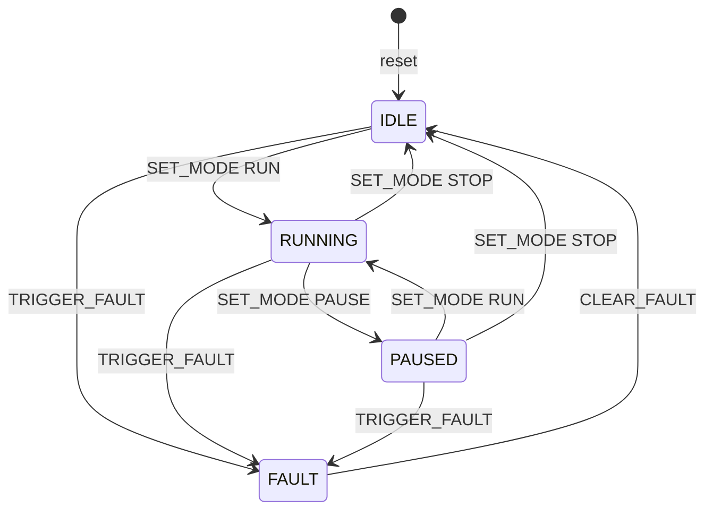

# STM32 Command Protocol Spec v0.1

28 Oct 2026 · Efrin Joseph

## 1. Purpose and scope

This spec defines how a PC talks to the STM32F407 board over UART: the link settings, the message format, the 6 commands, the replies and the state machine behind them.

Three things are built from this one page:

1. The STM32 firmware (C, bare-metal)
2. The Python/pytest test harness that checks the firmware
3. The SystemVerilog RTL twin and its UVM testbench

If the firmware or the RTL behaves differently from this page, the implementation is wrong, not the spec. Changes to behaviour start here, get a new version number, and then flow into the code and tests.

## 2. Physical link

The board uses USART1 at 115200 baud, 8N1, through a USB-to-UART adapter. The ST-LINK is only for flashing and debugging.

| Setting | Value |
| --- | --- |
| Peripheral | USART1 (on APB2 bus, clock enable in RCC_APB2ENR) |
| Board TX | PA9, alternate function AF7 → adapter RX |
| Board RX | PA10, alternate function AF7 → adapter TX |
| Ground | Board GND → adapter GND |
| Adapter VCC | Not connected (board has its own power) |
| Logic level | 3.3 V |
| Baud rate | 115200 |
| Frame | 8 data bits, no parity, 1 stop bit (8N1) |
| Flow control | None |

Adapter used: Silicon Labs CP2102, multi-mode board (TTL / RS-232 / RS-485). Both DIP switches must be ON for TTL mode, otherwise nothing comes through. The voltage jumper must be on 3V3.

## 3. Message framing

Messages are plain ASCII text, one command per line. You can type them by hand in a serial terminal and read the replies directly.

- **REQ-F1:** A command ends with a newline, `\n` (byte 0x0A).
- **REQ-F2:** A carriage return, `\r` (0x0D), is ignored. Windows terminals send `\r\n`, and both must work.
- **REQ-F3:** Command words and arguments are uppercase, separated by exactly one space.
- **REQ-F4:** A line holds at most 31 characters before the `\n`. A longer line is thrown away, and the board replies `NACK 04` once the `\n` arrives.
- **REQ-F5:** An empty line (only `\n`) is ignored, with no reply.
- **REQ-F6:** Every reply from the board ends with `\r\n`, so terminals show each reply on its own line.

Why text and not binary: text is easy to debug by eye. The cost is that parsing takes more work, in C and in RTL. For 6 short commands, that cost is small.

## 4. Commands

The PC can send exactly 6 commands. Anything else is answered with `NACK 01`.

| Command | Argument | What it does | Success reply |
| --- | --- | --- | --- |
| `PING` | none | Checks the link is alive | `ACK PING` |
| `GET_STATE` | none | Asks for the current FSM state | `STATE <name>` |
| `SET_MODE` | `RUN`, `PAUSE` or `STOP` | Moves the FSM to another state | `ACK SET_MODE` |
| `SET_LED` | `ON` or `OFF` | Switches the user LED | `ACK SET_LED` |
| `TRIGGER_FAULT` | none | Forces the FSM into FAULT (simulates an error) | `ACK TRIGGER_FAULT` |
| `CLEAR_FAULT` | none | Leaves FAULT, back to IDLE | `ACK CLEAR_FAULT` |

- **REQ-C1:** Every ACK repeats the command name. The test harness uses it to check that the reply belongs to the command it sent.
- **REQ-C2:** `PING` and `GET_STATE` work in every state.
- **REQ-C3:** `SET_LED` works in IDLE, RUNNING and PAUSED. In FAULT it is refused, and the LED is forced off when FAULT is entered.

LED used: D2 on the board. D2 is on PA6, confirmed on the board with a bare-metal blink test. D2 is active low, also confirmed on the board: writing 0 to ODR bit 6 turns it on. So `SET_LED ON` clears bit 6, `SET_LED OFF` sets it, and "LED forced off" in FAULT means bit 6 = 1.

## 5. Responses and error codes

The board answers every non-empty line with exactly one reply: `ACK`, `NACK`, `STATE` or, once after reset, `READY`.

| Reply | Meaning |
| --- | --- |
| `ACK <command>` | Command understood and carried out |
| `STATE <name>` | Answer to `GET_STATE`: IDLE, RUNNING, PAUSED or FAULT |
| `NACK <code>` | Command refused, nothing changed |
| `READY` | Sent once after power-up or reset |

| Code | Name | When |
| --- | --- | --- |
| `01` | Unknown command | Command word is not one of the 6, for example `HELLO` |
| `02` | Not allowed in this state | Command is valid but the transition table forbids it, for example `CLEAR_FAULT` in IDLE |
| `03` | Bad argument | Argument missing or wrong, for example `SET_MODE FLY` or `SET_LED` alone |
| `04` | Line too long | More than 31 characters before `\n` |

- **REQ-R1:** A NACK never changes the state or the LED.
- **REQ-R2:** When several errors apply, the board reports the first one in this order: 04, 01, 03, 02. Example: `SET_MODE FLY` in FAULT gives `NACK 03`, not `02`, because the argument is checked before the state.

## 6. State machine

The FSM has 4 states. It starts in IDLE, any state can be forced into FAULT, and only `CLEAR_FAULT` brings it back.



`PING`, `GET_STATE` and `SET_LED` are not drawn: they never change the state.

The table is the exact rule. Each cell says what happens when that command arrives in that state.

| From state | SET_MODE RUN | SET_MODE PAUSE | SET_MODE STOP | TRIGGER_FAULT | CLEAR_FAULT |
| --- | --- | --- | --- | --- | --- |
| IDLE | → RUNNING | NACK 02 | NACK 02 | → FAULT | NACK 02 |
| RUNNING | NACK 02 | → PAUSED | → IDLE | → FAULT | NACK 02 |
| PAUSED | → RUNNING | NACK 02 | → IDLE | → FAULT | NACK 02 |
| FAULT | NACK 02 | NACK 02 | NACK 02 | NACK 02 | → IDLE |

- **REQ-S1:** After reset the state is IDLE.
- **REQ-S2:** The state changes only as this table allows. Every arrow cell replies `ACK <command>`; every NACK cell leaves the state unchanged.
- **REQ-S3:** `PING` and `GET_STATE` work in all 4 states. `SET_LED` works in all states except FAULT. None of the three changes the state.

The 20 cells in the table give exactly 20 test cases for the state machine, one per cell.

## 7. Reset and timing

After reset the board is in IDLE with the LED off, and it says `READY` once.

- **REQ-T1:** After power-up or reset: state = IDLE, LED = off, receive buffer empty, then the board sends `READY\r\n` once.
- **REQ-T2:** The board finishes its reply within 10 ms of receiving the `\n`.
- **REQ-T3:** The test harness waits up to 100 ms for a reply. No reply in that time counts as a test failure.
- **REQ-T4:** Commands are handled one at a time, in the order they arrive. The PC waits for each reply before sending the next command.

The 10 ms limit is generous. At 115200 baud one character takes about 87 µs, so even a 20-character reply needs under 2 ms on the wire.

## 8. Example session

A normal run, then a fault and its recovery. `>` is what the PC sends, `<` is what the board replies.

```
<  READY
>  PING
<  ACK PING
>  GET_STATE
<  STATE IDLE
>  SET_MODE RUN
<  ACK SET_MODE
>  SET_LED ON
<  ACK SET_LED
>  SET_MODE PAUSE
<  ACK SET_MODE
>  TRIGGER_FAULT
<  ACK TRIGGER_FAULT
>  SET_MODE RUN
<  NACK 02
>  SET_LED ON
<  NACK 02
>  HELLO
<  NACK 01
>  CLEAR_FAULT
<  ACK CLEAR_FAULT
>  GET_STATE
<  STATE IDLE
```

After `CLEAR_FAULT` the LED stays off, because entering FAULT switched it off (REQ-C3).

## 9. Requirements and traceability

Every rule has an ID, and every test names the IDs it checks. So for each requirement you can show the test that proves it.

| Group | IDs | Checked by |
| --- | --- | --- |
| Framing | REQ-F1 to F6 | pytest: line endings, `\r` handling, too-long line, empty line |
| Commands | REQ-C1 to C3 | pytest: one test per command, ACK carries the name |
| Responses | REQ-R1 to R2 | pytest: NACK leaves state unchanged, error priority |
| State machine | REQ-S1 to S3 | pytest: one test per transition-table cell |
| Reset and timing | REQ-T1 to T4 | pytest: `READY` after reset, reply within 100 ms |

The same IDs are reused by the SystemVerilog testbench. A UVM scoreboard checks the same replies, and functional coverage shows that every command, state and transition was hit at least once.

**Change log**

| Version | Date | Change |
| --- | --- | --- |
| v0.1 | 28 Oct 2026 | First draft |
